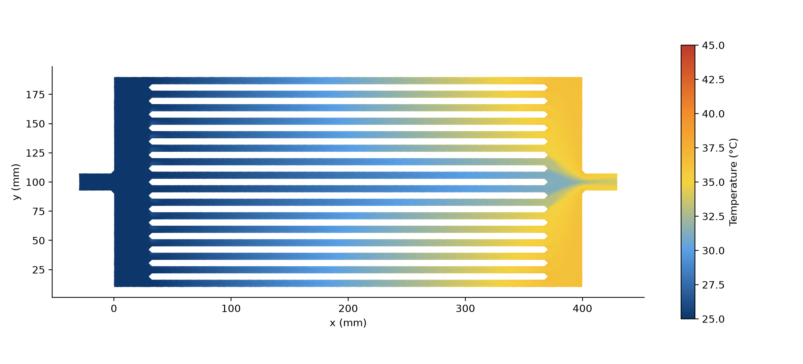
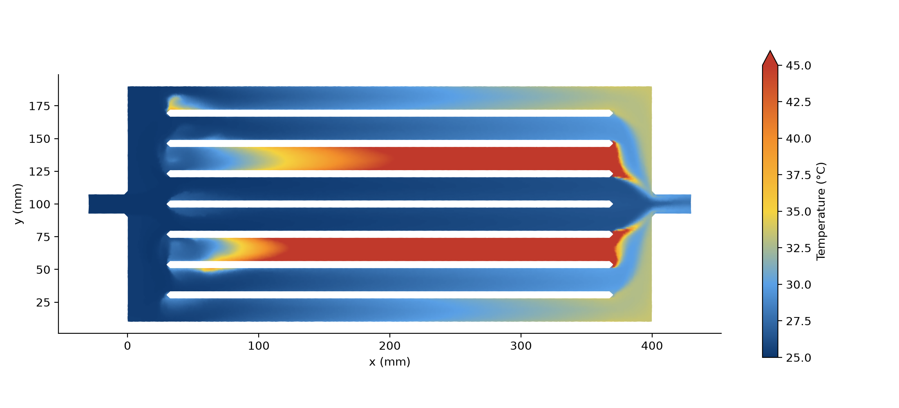
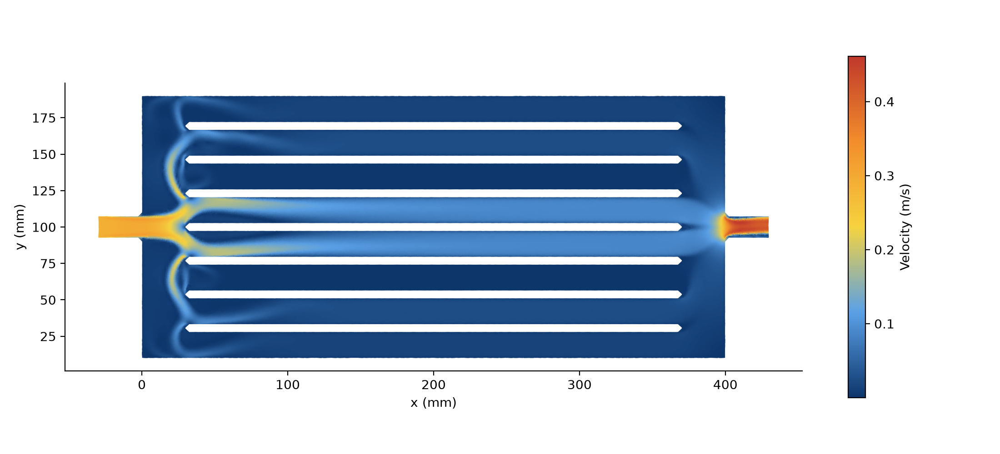
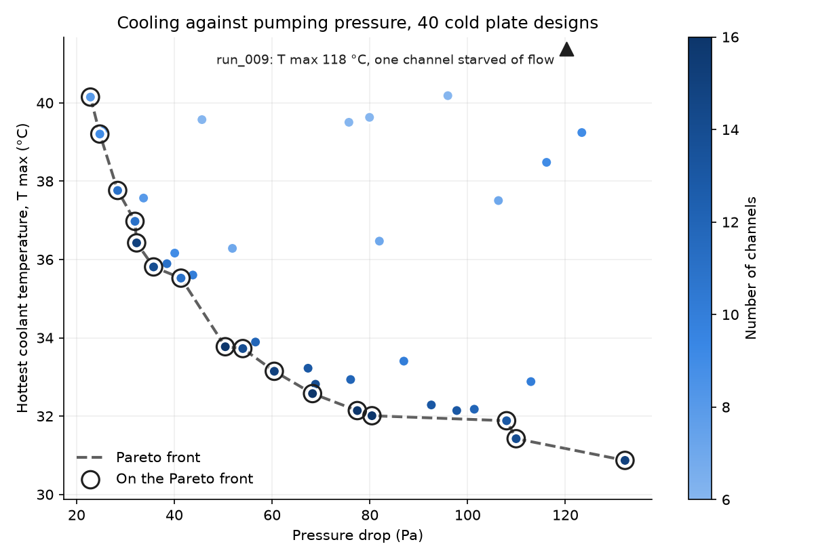
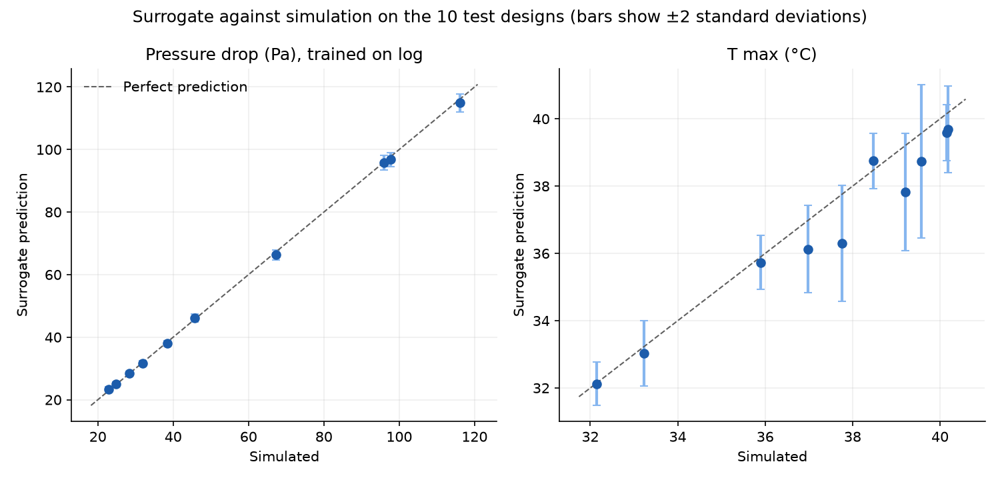
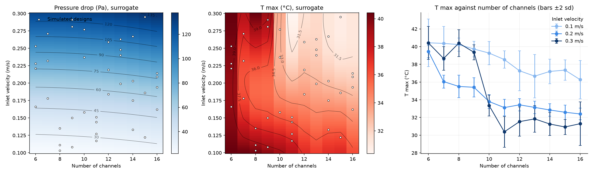
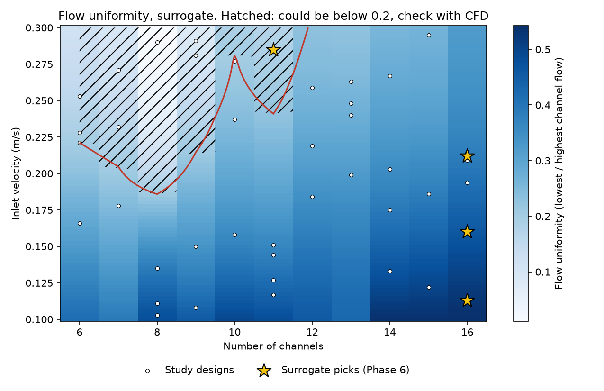
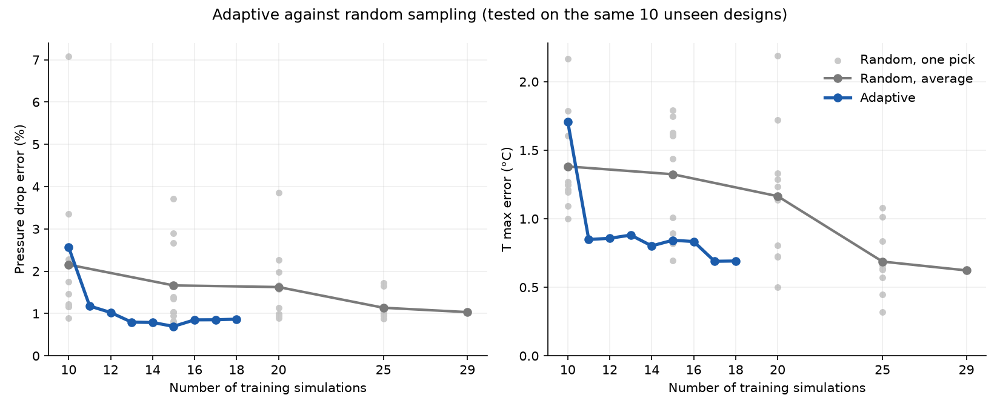
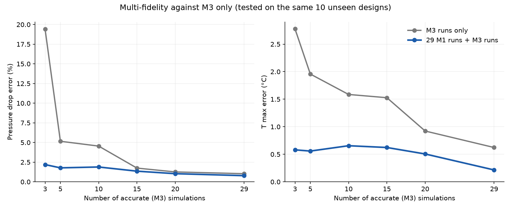

# Cold Plate CFD Surrogate

An automated CFD study and machine learning surrogate for a liquid cooled battery cold plate, built with OpenFOAM, Gmsh and scikit-learn.

The plate has parallel water channels under a battery giving off 200 W. More channels and faster flow cool the battery better, but need a stronger pump. This project maps that trade-off with 40 automated simulations, trains a Gaussian process surrogate that predicts any design in a fraction of a second, checks it against fresh CFD runs, and then tests three ways of getting a good surrogate from fewer expensive simulations.



## Headline results

- **The trade-off:** along the Pareto front, the hottest coolant temperature falls from 40.1 to 30.9 °C as the pressure drop rises from 23 to 132 Pa. Most of the gain comes early: the sweet spot is about 35 to 55 Pa.
- **More channels win:** nearly every Pareto design has 11 to 16 channels. Slower flow shares water more evenly between channels, because the inlet jet dies out sooner.
- **Pumping harder can starve a channel:** at 8 channels and 0.29 m/s, the jet sends almost all the water down the middle channels, and one channel gets 1.4% of the flow of the busiest.
- **Surrogate accuracy on unseen designs:** pressure drop within about 1% (smaller than the mesh error), hottest temperature within 0.6 °C, with uncertainty bands that contained all 10 test designs.
- **Speed:** the surrogate predicts 891 designs in about a second, against roughly 90 hours of CFD.
- **Checked with new CFD runs:** the surrogate's best design for a 30 Pa pump was confirmed and beat every design in the original study. Its 120 Pa pick failed, in a jet dominated design, and a flow uniformity flag added afterwards would have warned about it in advance.
- **Adaptive sampling:** letting the surrogate choose where to simulate reached the same accuracy with about 30% fewer simulations than random sampling.
- **Multi-fidelity:** 29 cheap coarse mesh runs plus 5 accurate runs matched a surrogate built from 29 accurate runs, for about a quarter of the computing time.

| Even flow: 16 channels, 0.113 m/s | Starved channel: 8 channels, 0.29 m/s |
| --- | --- |
|  |  |

Both on the same scale (25 to 45 °C). In the 8 channel design, the fast inlet jet runs straight down the middle channels, and one outer channel gets almost no water, so it overheats:



## The problem

| | |
|---|---|
| Plate | 400 × 200 mm, 30 mm headers at each end, 15 mm inlet and outlet ports |
| Channels | 6 to 16 parallel channels, 3 mm deep, 5 mm metal strips between them |
| Coolant | water, entering at 25 °C, inlet velocity 0.1 to 0.3 m/s (laminar) |
| Heat | 200 W from the battery, the same for every design |
| Outputs | pressure drop Δp, hottest coolant temperature T max, flow uniformity (lowest / highest channel flow) |

## The model

- **2.5D flow:** the plate is solved in 2D, with the friction of the top and bottom walls added as a depth friction term (Darcy friction 12/h² for a 3 mm gap). This keeps each design at about 55,000 to 68,000 cells, so a full design runs in about 6 minutes on 6 cores.
- **Flow:** laminar, solved pseudo-transiently with `pimpleFoam`, because the steady solver would not converge on fine meshes.
- **Temperature:** solved afterwards on the frozen flow with `scalarTransportFoam` (one-way coupling), with the battery heat added as a uniform source in the water of the channel section.
- **Main simplification:** there is no metal in the model, so heat cannot spread sideways from a starved channel to its neighbours. The overall temperature rise is exact, but differences between channels, and so T max in badly balanced designs, are overstated.

## Verification and validation

**Validation against exact solutions.** A single straight channel was compared with the analytical solutions for flow between two walls and for the 2.5D model with depth friction (Brinkman flow). The error fell from 2.4% to 0.3% as the cells were refined, confirming the solver, boundary conditions and friction term.

**Mesh study.** The baseline design on four meshes:

| Mesh | Main / wall cells | Cells | Δp (Pa) | T max (°C) |
|---|---|---|---|---|
| M1 | 2 / 2 mm | 17,358 | 86.62 | 40.28 |
| M2 | 2 / 1 mm | 27,816 | 88.40 | 38.80 |
| **M3** | **1.4 / 0.7 mm** | **54,740** | **93.99** | **40.06** |
| M4 | 1 / 0.5 mm | 103,218 | 95.51 | 41.37 |

Richardson extrapolation puts the mesh independent Δp at about 96 to 97 Pa, so M3 (used for the study) is about 3% low. The error is consistent between designs, so it largely cancels when comparing them.

**Checks on every run:** the outlet temperature matched the energy balance to within 0.002 °C, the flow balanced to 0.0%, and Δp changed by less than 0.1% over the last fifth of each run. A repeated run gave the same Δp and T max to within 0.02%.

## The design study

40 designs chosen with a Latin hypercube (channels 6 to 16, inlet velocity 0.1 to 0.3 m/s, fixed seed), 30 for training and 10 kept aside for testing. One script builds the geometry and mesh, sets up the case, runs the flow and temperature, and reads the results, so the whole study ran unattended in 4.2 hours. All 40 converged.



## The surrogate

A Gaussian process for each output, with a separate length scale for channels and velocity. Model choices were made on the 10 unseen test designs:

- **Pressure drop** is learned on a log scale, which turns its curved rise with velocity into something close to a straight line. Mean test error 0.55 Pa (about 1%).
- **T max** changes sharply from one channel count to the next. The first model was overconfident (5 of 10 test designs outside its 95% band). Allowing a small noise floor fixed this: mean error 0.62 °C, all 10 inside the band.



The final surrogate maps every design and finds the coolest one for any pump:



| Pump budget | Surrogate's pick | Predicted T max | CFD check |
|---|---|---|---|
| 30 Pa | 16 channels, 0.113 m/s | 35.8 ± 1.7 °C | **36.9 °C**, inside the band, and better than any study design at that budget |
| 120 Pa | 11 channels, 0.285 m/s | 30.6 ± 1.4 °C | **33.5 °C**, outside the band: the centre channel took 26% of the flow |

**Lesson:** pressure drop depends on the whole plate and changes smoothly, so it is easy to learn. T max is set by the single worst channel, and it can jump when the inlet jet takes over. A surrogate on channels and velocity alone cannot see that coming.

## Upgrades

**1. A flag for jet dominated designs.** A third surrogate predicts flow uniformity and flags any design that could fall below 0.2. Trained only on the original 40 designs, it flags the failed 120 Pa pick and passes the three good ones.



**2. Adaptive sampling.** Starting from 10 designs, the surrogate repeatedly picked the design it was least sure about, which was then run in CFD. One well chosen run halved the T max error, and with 17 simulations in total (10 random plus 7 chosen) it matched what random sampling needed 25 for.



**3. Multi-fidelity.** All 40 designs were rerun on the coarse M1 mesh (0.5 min each, against 7.2 min on M3). A surrogate learns the overall shape from the cheap runs, and a second one learns the gap between M1 and M3 from a few accurate runs.

| Training runs | Computing time | Δp error | T max error |
|---|---|---|---|
| 29 accurate (M3) | 209 min | 1.0% | 0.62 °C |
| 29 cheap (M1) + 5 accurate | 51 min | 1.8% | 0.56 °C |
| 29 cheap + 29 accurate | 224 min | 0.8% | 0.22 °C |



## Limitations and next steps

- **No metal in the model.** A conjugate heat transfer model would show the true T max in starved channels, and would add the benefit narrow channels get from more wall area, which this model leaves out.
- **Mesh error.** M3 is about 3% low on Δp. A few designs should be confirmed on M4.
- **More design variables.** Header length and port width affect the flow split strongly and are natural next inputs.
- **Smarter sampling.** Choosing runs by uncertainty alone spends many runs on the edges of the design space. Methods that also weigh how promising a design is would aim the runs better.
- **Differentiable solver.** A simple flow solver in JAX would give gradients of Δp with respect to the geometry, for direct design optimisation.

## Repository layout

| Path | What it holds |
|---|---|
| `study.yaml` | all study settings (plate size, ranges, mesh, heat) |
| `src/geometry.py` | builds the plate geometry and mesh in Gmsh |
| `src/make_case.sh`, `src/frozen_T.sh` | set up an OpenFOAM case, and solve the temperature on the frozen flow |
| `src/run_case.py`, `src/run_all.py` | run one design from start to finish, and run the whole study |
| `src/doe.py` | chooses the 40 designs (Latin hypercube) |
| `src/validate_channel.py` | the straight channel validation |
| `src/surrogate.py`, `src/surrogate_maps.py` | train, test and use the surrogate |
| `src/uniformity.py`, `src/sampling.py`, `src/adaptive.py`, `src/multifidelity.py` | the uniformity flag and the sampling experiments |
| `src/plot_fields.py` | draws the temperature and velocity pictures from a finished case |
| `case_template/`, `case_template_pseudo/` | OpenFOAM case settings |
| `designs.csv`, `results.csv`, `results_M1.csv` | the designs and their results |
| `results/` | all plots |
| `DESIGN_NOTES.md` | every decision, finding and check, in full |

## Running it

Requires OpenFOAM v2512 and Python 3 with the packages in `requirements.txt`.

```bash
openfoam2512
python3 -m venv .venv
source .venv/bin/activate
pip install -r requirements.txt

python src/doe.py              # choose the 40 designs
python src/run_all.py          # run them all (about 4 hours on 6 cores)
python src/plot_tradeoff.py    # trade-off plot and Pareto front
python src/surrogate.py        # train and test the surrogate
python src/surrogate_maps.py   # maps and best designs
python src/plot_fields.py runs/run_009_heat T results/temperature_run009.png 25 45   # field picture
```

The full reasoning behind every choice, including what went wrong and how it was fixed, is in [DESIGN_NOTES.md](DESIGN_NOTES.md).