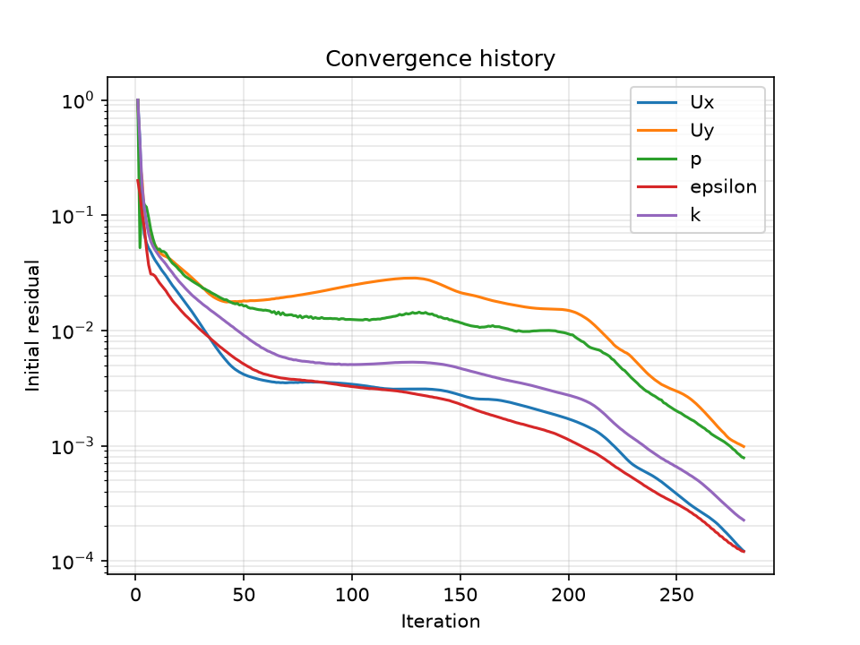

# Learning log: Phase 1, OpenFOAM basics

## Setup
- What I installed and why:
  - WSL: lets me run Linux alongside Windows on my laptop.
  - Ubuntu: the Linux system I work in.
  - OpenFOAM v2512: the CFD software that meshes and solves the flow.
  - ParaView: the program I use to view and check OpenFOAM results.
  - Python environment: to create the geometry and mesh, automate the runs, and train the surrogate model.
- Why simulations run in Linux, but I view results in Windows ParaView:
  OpenFOAM is built for Linux and runs fastest there. ParaView in Linux had to send its graphics through WSL, which made it slow ("copy mode") and drew some colourings incorrectly (a black strip). Windows ParaView uses my graphics card directly, so I copy cases to Windows with my `pvcase` shortcut and view them there.

## How an OpenFOAM case is organised
- `0/`: the starting values and boundary conditions for each field (velocity, pressure, turbulence), including what happens at each wall, inlet and outlet.
- `constant/`: things that don't change during the run: the mesh (in `constant/polyMesh`) and the physical properties, such as viscosity and the turbulence model.
- `system/`: the settings for how the simulation runs: end time and how often to save (`controlDict`), numerical methods (`fvSchemes`, `fvSolution`) and the mesh instructions (`blockMeshDict`).

## Commands I used
| Command | What it does |
|---|---|
| `blockMesh` | Creates the whole mesh, filling the volume with cells, from the instructions in `system/blockMeshDict` |
| `checkMesh` | Checks the mesh: counts (cells, faces) and quality (for example skewness, non-orthogonality) |
| `icoFoam` | Simulates laminar, incompressible flow through time (transient) |
| `simpleFoam` | Solves steady, incompressible, turbulent flow, iterating until the answer stops changing |
| `pisoFoam` | Simulates incompressible flow through time, and can use a turbulence model |
| `mapFields` | Copies results from one case onto another case's mesh, to use as its starting point |
| `foamListTimes -rm` | Deletes the result folders, keeping `0`, `constant` and `system` |
| `foamCleanTutorials` | Resets a case completely, including the mesh |

## Tutorials I ran and what each taught me
- cavity: a lid moving at 1 m/s drags the fluid into a swirl. My first full cycle of mesh, solve and view.
- cavityFine: a finer mesh (40 × 40 cells instead of 20 × 20). I had to halve the time step to keep the Courant number at about 1 or less, so the flow doesn't travel more than one cell per step.
- cavityGrade: a graded mesh with smaller cells near the walls, where the flow changes fastest. It started from cavityFine's results using `mapFields`.
- cavityHighRe: viscosity lowered 10 times, so the Reynolds number went from 10 to 100. The swirl moved and the pressure range became smaller.
- cavityRAS: a turbulent cavity using `pisoFoam`. The newer tutorial needed `0.orig` copied to `0`, and its extra function objects switched off.
- pitzDaily: steady turbulent flow over a backward-facing step using `simpleFoam`. It taught me convergence, recirculation and reattachment.

## pitzDaily results
- Converged in 281 iterations. The solver stops when every field's residual falls below its target. Uy was the last to fall below its target of 1e-3, so it decided when the run stopped.
- The residual plot: a fast drop for the first 40 iterations, then a plateau from about 50 to 200 where progress was slow while the swirl behind the step settled (relaxation factors only let the solution change a little each iteration), then a second drop to convergence.
- Reattachment length: 0.171 m ≈ 6.7 step heights (step height 0.0254 m). I measured it with Plot Over Line just above the floor, finding where Ux changes from negative (backward flow) to positive, using linear interpolation between the two sample points either side of zero.
- At iteration 100 the reattachment point was in a different place, which showed me why I must wait for convergence before trusting a result.
- Next: compare with the Pitz and Daily (1983) experiment. The k-epsilon turbulence model used here is known to predict reattachment too early on backward-facing steps.

## Physics I learnt
- Residuals and convergence: each iteration, the solver checks how well its current guess obeys the laws of physics (mass in = mass out, and forces balancing) in every cell. The leftover mismatch is the residual. "Better" means the mismatch gets smaller. Converged means it is below the target everywhere, so the answer obeys the laws of physics closely enough.
- Steady vs transient solvers: a steady flow looks the same at every moment, so a steady solver skips time and finds that one pattern directly by iterating. Steady solvers still say "Time" because they reuse OpenFOAM's time loop with a step of 1, so "Time = 281" means iteration 281, not seconds.
- Bernoulli's principle: where velocity rises, pressure falls, and vice versa. It only applies along one stream of fluid, in steady flow, at constant density, with no energy lost to friction. It doesn't link separate regions, such as the main jet and the trapped swirl behind the pitzDaily step.
- Pressure loss: friction with the walls takes energy from the water, and that energy doesn't come back. Narrow channels lose much more, because all the water is close to a wall (the loss per metre goes up with 1/width²). So the pump needs a higher inlet pressure to keep the same flow going.
- Why more channels cool the chip better: the heat only has a short distance to travel into the water, so all of the water absorbs heat (higher heat transfer coefficient), and more channels also means more wall area touching the water. The cost is a bigger pressure drop.

## Problems I solved
- ParaView black strip: Linux ParaView drew some colourings as a black strip because of how WSL handles graphics. Software graphics (`LIBGL_ALWAYS_SOFTWARE=1`) fixed the drawing but was slow, so I switched to Windows ParaView and made a `pvcase` shortcut that copies the case to Windows and opens it.
- `0.orig` instead of `0`: newer tutorials keep a clean copy of the starting conditions in `0.orig`. The solver needs a `0` folder, so I copied it with `cp -r 0.orig 0`.
- Function objects in the newer cavityRAS tutorial: it ran lots of extra post-processing tools, which wrote extra time folders and gave a uniform, unphysical velocity. Running `pisoFoam -noFunctionObjects` fixed it.
- Windows line endings (CRLF): a file edited on the Windows side got Windows line endings, which added an invisible character in Linux and broke my shortcut. I fixed it with `sed -i 's/\r$//'` and set VS Code to use LF by default.
- Old results left in the Windows copy: rsync adds and updates files but never deletes them, so old time folders stayed in the Windows copy. I deleted the Windows copy and copied it again fresh.

